<div align="center">


# 🎵 Queue (`q`) — The Ultimate MPV Music Engine

<p align="center">
  <b>Turn lightweight MPV into an intelligent, feature-packed terminal music player.</b><br>
  <i>24/7 Auto-Discovery • Instant YouTube & SoundCloud Streaming • Interactive FZF TUI • Dual-Engine Hardware Acceleration</i>
</p>

<p align="center">
  <a href="#-quick-start"></a>
  
  
  
  
</p>

<p align="center">
  <a href="#-what-is-queue-q"><b>What is Queue?</b></a> •
  <a href="#-interactive-tui-preview"><b>TUI Preview</b></a> •
  <a href="#-quick-start"><b>Quick Start</b></a> •
  <a href="#-everyday-usage"><b>Everyday Usage</b></a> •
  <a href="#-dual-engine-architecture"><b>Dual-Engine Modes</b></a> •
  <a href="#-command-cheat-sheet"><b>Commands</b></a> •
  <a href="#-documentation-index"><b>Documentation</b></a>
</p>

---

</div>

## 🌟 What is Queue (`q`)?

**Queue** (invoked everywhere as **`q`**) is a unified command center designed for music lovers who live in the terminal. Instead of reinventing media playback or packing heavy Electron runtimes, Queue bridges **MPV**, **yt-dlp**, **fzf**, **jq**, and **netcat**—transforming a barebones CLI player into a rich, reactive, background-resilient streaming powerhouse.

<p align="center">
  
</p>

### 🧩 Core Stack:
| Tool | Role in `q` |
| :--- | :--- |
| 🎬 **[MPV](https://mpv.io/)** | High-fidelity audio backend, Dolby Spatial FX, and Direct3D/MediaCodec video |
| 📥 **[yt-dlp](https://github.com/yt-dlp/yt-dlp)** | Decrypts and streams audio directly from YouTube & SoundCloud without local files |
| 🔍 **[fzf](https://github.com/junegunn/fzf)** | Lightning-fast fuzzy search interface with live now-playing track banners |
| ⚡ **netcat & jq** | Zero-latency JSON-IPC channel controlling playback without process restarts |

---

## 🖥️ Interactive TUI Preview

Launch the full-screen interactive queue simply by typing `q`:

<p align="center">
  
</p>

### ⚡ Why Queue vs Standard Players?

| Feature | Queue (`q`) | Spotify / Desktop Apps | Plain MPV CLI |
| :--- | :---: | :---: | :---: |
| **RAM Usage** | **< 15 MB** | 500 MB – 1.2 GB (Electron) | ~15 MB |
| **24/7 Smart Auto-Discovery** | ✅ (`q -auto` Seed Rotation + Taste Profile) | ✅ (Algorithm) | ❌ |
| **Auto-Added Ⓐ Track Tagging** | ✅ Distinct Ⓐ branding on auto hits | ❌ None | ❌ None |
| **Isolated Blind Mode** | ✅ `q -pb` (Zero-touch queue snapshot) | ❌ Interrupts playback | ⚠️ Basic file open |
| **Multi-Language Audio Dubs** | ✅ `q -lang` (Dual-session selector) | ❌ None | ⚠️ Manual CLI flags |
| **Pure Audio-Only Stream** | ✅ `q -aud` (98% bandwidth reduction) | ❌ Downloads video/canvas | ⚠️ Requires `--no-video` |
| **YouTube & SoundCloud Streaming** | ✅ Zero local storage | ❌ Spotify catalog only | ⚠️ Single URLs only |
| **Spotify Track Resolver** | ✅ Auto-matches studio audio | ❌ Requires app/login | ❌ None |
| **Desktop Video Window** | ✅ `q -vid` (120+ FPS / Resizable) | ⚠️ Fixed heavy desktop GUI | ⚠️ Blocks terminal |
| **Headless Background Daemon** | ✅ Continuous (`setsid`) | ❌ Window required | ❌ Terminal bound |
| **Interactive Fuzzy Search (FZF)** | ✅ Instant (0ms) | ⚠️ Slower GUI search | ❌ None |
| **Zero-Repeat Virtual Shuffle** | ✅ Smart history stack | ⚠️ Repeat prone | ❌ Primitive shuffle |
| **Liked Songs & Dislike Hub** | ✅ `q -liked` / `q -like` / `q -disl` / `CTRL-L` / `CTRL-D` | ⚠️ Cloud playlist only | ❌ None |

---

## 🚀 Quick Start

### ⚡ 1-Line Universal Setup (Recommended)
Install Queue on any device (**Linux**, **macOS**, **Windows WSL2**, **Android Termux**) in seconds without cloning the repository:

```bash
# Standard Standalone Mode (Headless / Native Audio & 60 FPS Video)
curl -fsSL https://raw.githubusercontent.com/ravin-ship-it/queue/main/setup.sh | bash

# Or enable Hybrid Boost Mode directly (Windows 120+ FPS / Android Hardware)
curl -fsSL https://raw.githubusercontent.com/ravin-ship-it/queue/main/setup.sh | bash -s -- --hybrid
```

> [!TIP]
> **100% Self-Contained Engine**: Queue is permanently installed into `~/.local/bin/mpv`. Cloned folders can be safely deleted. If you ever uninstall, Queue preserves an instant reinstaller so running **`q install`** restores Queue anytime!

### 💻 Manual Git Clone
```bash
git clone https://github.com/ravin-ship-it/queue.git
cd queue
./install.sh
source ~/.bashrc   # or: source ~/.zshrc
```
*(For detailed OS-specific setup guides, see [docs/INSTALLATION.md](file:///home/xen/queue/docs/INSTALLATION.md))*

---

## 🕹️ Everyday Usage

<p align="center">
  
</p>

```bash
# 1. Search YouTube and pick from top results
q "linkin park in the end"

# 2. Force specific provider search
q yt "synthwave radio"
q sc "lofi chill beats"

# 3. Stream a direct YouTube video or entire playlist
q "https://www.youtube.com/watch?v=dQw4w9WgXcQ"
q "https://www.youtube.com/playlist?list=PL..."

# 4. Stream Spotify tracks (auto-matches studio audio on YouTube)
q "https://open.spotify.com/track/5PKvWxm8RCfgVE2A1cLP7u"

# 5. Toggle Desktop Video Window (F11 Fullscreen, w/W sizing, +/- scale)
q -vid

# 6. Stream local folder or file
q ~/Music/favorite_song.mp3
```

---

## ⚡ Dual-Engine Architecture

Queue adapts its rendering and audio engine based on the host platform:

* **Windows + WSL2**:
  * **Standalone WSL Mode**: Zero Windows config, 60 FPS capped via WSLg Mesa D3D12.
  * **Hybrid Boost Mode**: Uncapped **120+ FPS Direct3D 11/12**, native **Windows WASAPI** low-latency audio, and sub-millisecond Named Pipe IPC via `PipeRelay.exe`. Toggle anytime with `q -hybrid on`.
* **Android (Termux)**:
  * **Standalone Termux Mode**: Headless MPV audio daemon with CPU wake-lock (ultra-low battery).
  * **Hybrid Mobile Mode**: Hardware **MediaCodec GPU acceleration**, **AudioTrack hardware tunneling**, and Picture-in-Picture via the official [MPV Android App](https://play.google.com/store/apps/details?id=is.xyz.mpv).
* **Linux & macOS**: Direct kernel GPU/audio hardware acceleration (Wayland, X11, PipeWire, Metal, CoreAudio).

*(For architecture deep dives, see [docs/MODES.md](file:///home/xen/queue/docs/MODES.md))*

---

## 📋 Command Cheat Sheet

| Command | Action |
| :--- | :--- |
| `q` | Open Interactive FZF Queue (TAB to select, ENTER to play) |
| `q <query>` | Search YouTube & select track |
| `q -p [N]` | Play/Pause or jump to track `N` |
| `q -pb [target]` | **Blind Mode**: One-time isolated play (pauses queue, restores on exit) |
| `q -auto [cmd]` | **Smart Auto-Discovery**: 24/7 radio (`on`, `off`, `status`, `fetch`, `reset`, tagged `Ⓐ`) |
| `q -next` / `-prev` | Skip to next or previous track |
| `q -stop` | Stop playback and kill MPV background daemon |
| `q -shuf` | Toggle Smart Virtual Shuffle (Zero-repeat history stack) |
| `q -vid` | Toggle Desktop Video Window (Instant zero-gap toggle) |
| `q -aud [on\|off]` | **Audio-Only Mode**: 98% bandwidth reduction / pure Opus stream |
| `q -res [val]` | Set/Check video quality (`720`, `1080`, `1440`, `4k`, `auto`) |
| `q -speed [val]` | Set/Check playback speed (`0.25x` - `4.0x`, `reset`) |
| `q -lang [code]` | **Audio Language & Dub Switcher**: Multi-track dubs with Dual-Session Selector |
| `q -hybrid [on\|off]` | Switch between Standalone and Hybrid Boost engines |
| `q -like [N]` / `-unlike` | Like/Unlike track & save to Liked Songs (tagged `[🩷]`) |
| `q -liked` | **Liked Songs Hub**: Interactive FZF player & manager |
| `q -pl-load [N]` | **Playlist Hub**: Interactive FZF playlist explorer & loader |
| `q -pl-save <N>` | Save current queue as a custom named playlist |
| `q -dis [N]` / `-rmd` | Dislike track & blacklist from auto-discovery (tagged `[💔]`) |
| `q -disl` | **Dislike Hub**: Interactive FZF blacklist manager |
| `q -fx` | Toggle Dolby Equalizer & Spatial Audio FX |
| `q -d [N]` | Interactive Downloader Hub (MP3, FLAC, OPUS, MP4) |
| `q -deps` | Multi-Engine System & Dependencies Diagnostic |
| `q -up` | Universal 1-command Updater (yt-dlp, engine, local dev auto-sync) |
| `q -install` | Reinstall or verify Queue engine |
| `q -uninstall` | Clean uninstallation (preserves instant reinstaller) |
| `q -remove-setup` | Permanently wipe setup file (after uninstallation) |

*(For full syntax, parameters, and keybindings, see [docs/COMMANDS.md](file:///home/xen/queue/docs/COMMANDS.md))*

---

## 📚 Documentation Index

For in-depth guides and technical documentation:

| Document | Description |
| :--- | :--- |
| 📦 **[Installation Guide](file:///home/xen/queue/docs/INSTALLATION.md)** | Step-by-step OS setup, prerequisites, flags, and reinstallation lifecycle |
| ⚡ **[Multi-Engine Guide](file:///home/xen/queue/docs/MODES.md)** | Windows WSL2 Hybrid Boost, Android Termux Mobile, and Linux/macOS sinks |
| 🕹️ **[Command Reference](file:///home/xen/queue/docs/COMMANDS.md)** | Exhaustive reference for playback, search syntax, playlists, and hotkeys |
| 🔧 **[Troubleshooting Guide](file:///home/xen/queue/docs/TROUBLESHOOTING.md)** | Fixes for YouTube 403 throttles, premium traps, cursor scaling, and audio |

---

## 🤝 Contributing & License

Contributions, feature requests, and bug reports are warmly welcome! Feel free to open an issue or pull request.

Distributed under the **GPL-3.0 License**. See [LICENSE](file:///home/xen/queue/LICENSE) for more information.
