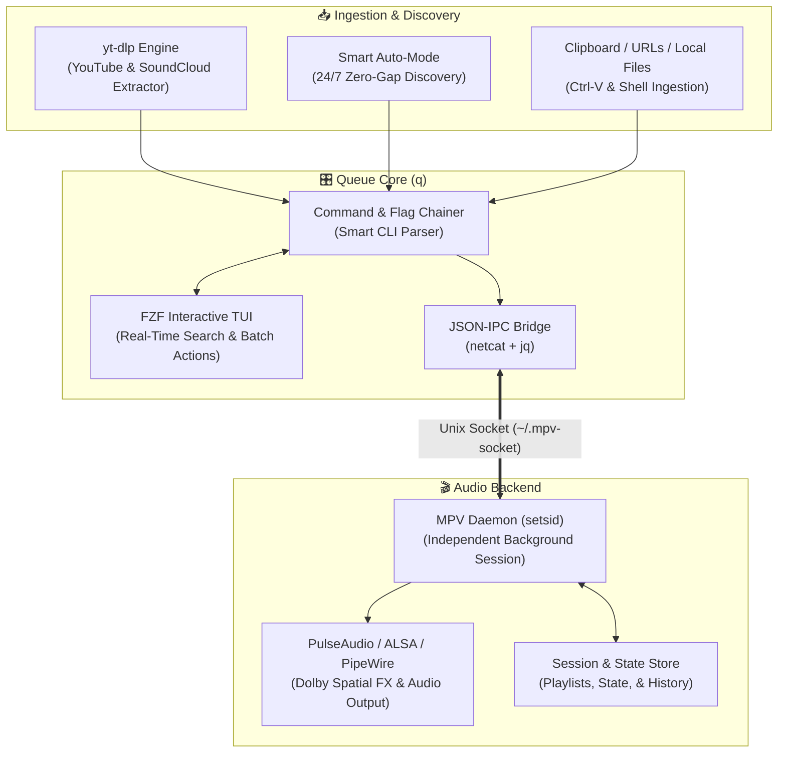

<div align="center">


# 🎵 Queue (`q`) — The Ultimate MPV Music Engine

<p align="center">
  <b>Turn lightweight MPV into an intelligent, feature-packed terminal music player.</b><br>
  <i>24/7 Auto-Discovery • Instant YouTube & SoundCloud Streaming • Interactive FZF TUI • Zero-Bloat</i>
</p>

<p align="center">
  <a href="#-quick-start"></a>
  
  
  
  
  
</p>

<p align="center">
  <a href="#-what-is-queue-q"><b>What is Queue?</b></a> •
  <a href="#-interactive-tui-preview"><b>TUI Showcase</b></a> •
  <a href="#-quick-start"><b>Quick Start</b></a> •
  <a href="#-step-by-step-installation-by-os"><b>Install by OS</b></a> •
  <a href="#-dual-engine-architecture--multiple-modes"><b>Dual-Engine Modes</b></a> •
  <a href="#-cheat-sheet"><b>Commands</b></a> •
  <a href="#-spotify-track-resolver-q-spotify_url"><b>Spotify Resolver</b></a> •
  <a href="#-desktop-video-window-q--vid--q--video"><b>Desktop Video Window</b></a> •
  <a href="#-unlocking-studio-audio-quality-youtube-cookies-setup"><b>Audio Quality & Cookies</b></a> •
  <a href="#-smart-auto-mode-q--auto"><b>Auto-Mode</b></a> •
  <a href="#-why-queue-vs-standard-players"><b>Why Queue?</b></a> •
  <a href="#-built-with-ai-augmented-development"><b>AI Development</b></a>
</p>

---

</div>

## 🌟 What is Queue (`q`)?

**Queue** (invoked everywhere via the convenient shorthand command **`q`**) is a unified command center designed for music lovers who live in the terminal. Instead of reinventing media playback, Queue elegantly bridges together the most powerful Unix tools—**MPV**, **yt-dlp**, **fzf**, **jq**, and **netcat**—transforming a barebones CLI player into a rich, reactive, background-resilient music player.

<p align="center">
  
</p>

<details>
<summary><b>🔍 View Raw Mermaid Flowchart Code</b></summary>



</details>

### 🧩 Under the Hood:
| Tool | Role in `q` |
| :--- | :--- |
| 🎬 **[MPV](https://mpv.io/)** | High-fidelity, ultra-lightweight audio backend and equalizer |
| 📥 **[yt-dlp](https://github.com/yt-dlp/yt-dlp)** | Decrypts and streams audio directly from YouTube & SoundCloud without local files |
| 🔍 **[fzf](https://github.com/junegunn/fzf)** | Lightning-fast fuzzy search interface with live now-playing banners |
| ⚡ **netcat & jq** | Zero-latency JSON-IPC channel controlling MPV without stopping playback |

---

## 🖥️ Interactive TUI Preview

Launch the full-screen interactive queue simply by typing `q`:

<p align="center">
  
</p>

## ⚡ Why Queue (`q`) vs Standard Players?

| Feature | Queue (`q`) | Spotify / Desktop Apps | Plain MPV CLI |
| :--- | :---: | :---: | :---: |
| **RAM Usage** | **< 15 MB** | 500 MB – 1.2 GB (Electron) | ~15 MB |
| **24/7 Smart Auto-Discovery** | ✅ (`q -auto` Zero-Gap) | ✅ (Algorithm) | ❌ |
| **YouTube & SoundCloud Streaming** | ✅ Zero local storage | ❌ Spotify catalog only | ⚠️ Single URLs only |
| **Spotify Track Resolver** | ✅ Auto-matches studio audio on YouTube | ❌ Spotify catalog only (requires app/login) | ❌ None |
| **On-Demand Desktop Video Window** | ✅ `q -vid` (WSLg / X11 / Resizable / F11) | ⚠️ Fixed heavy desktop GUI | ⚠️ Separate window or terminal only |
| **Headless Background Daemon** | ✅ Continuous (`setsid`) | ❌ Window required | ❌ Blocks terminal |
| **Interactive Fuzzy Search (FZF)** | ✅ Instant (0ms) | ⚠️ Slower GUI search | ❌ None |
| **Zero-Flicker Live Auto-Sync** | ✅ Atomic `reload-sync` (Virtual DOM)| ⚠️ Cloud polling delay | ❌ None |
| **Dynamic Live Player Indicators** | ✅ Left-aligned `\|>` / `\|\|` + Highlight | ⚠️ Basic GUI icon | ❌ None |
| **Zero-Stutter Audio Architecture** | ✅ 48kHz Resampler & 1s Buffer | ⚠️ High CPU usage | ⚠️ Sinks drop on load |
| **WSL2 / Linux Virtualization Hardened**| ✅ Native Pulse/SHM Bypass | ⚠️ Audio desync / crackle | ⚠️ Buffer underruns on VM |
| **Android / Termux 1-Click Support**| ✅ Autonomous package & driver setup | ⚠️ App crashes / battery drain | ⚠️ Manual driver config |
| **Taste Blacklisting & Dislike Hub**| ✅ `q -disl` / `q -rmd` / `CTRL-D` | ⚠️ Cloud thumbs down only | ❌ None |
| **Dead Link Auto-Cleaner** | ✅ `q -clean` | ❌ None | ❌ None |

---

## 🚀 Quick Start

### 1. Clone & Install
```bash
git clone https://github.com/ravin-ship-it/queue.git
cd queue
./install.sh
```

> **🛡️ Permanent & Self-Contained**: `install.sh` installs `q` permanently into `~/.local/bin/mpv/` so you can safely delete the cloned repository directory anytime without breaking `q`.
>
> **🚀 Universal Auto-Updates**: Run **`q -up`** (or `q up`) anytime from any directory to update both `yt-dlp` and the Queue engine directly from GitHub in 1 second!
>
> **🌍 Cross-Platform Compatibility**: Automatically configures dependencies across **Ubuntu/Debian/WSL**, **Arch Linux**, **Fedora**, **macOS (Homebrew)**, and **Termux (Android)** with universal Netcat (`nc`/`ncat`) detection.

### 2. Apply Shell Integration
```bash
# For Zsh users:
source ~/.zshrc

# For Bash users:
source ~/.bashrc
```

### 3. Play Music!
```bash
# Open interactive player:
q

# Search & play instantly from YouTube:
q "blinding lights the weeknd"
```

---

## 📦 Step-by-Step Installation by OS

Queue is designed to be 100% self-contained and automatically configures its environment. Below are step-by-step instructions tailored for each operating system:

<details open>
<summary><b>🐧 Ubuntu / Debian / Kali / Linux Mint / Pop!_OS</b></summary>

```bash
# 1. Install prerequisites (optional, installer will auto-detect & offer)
sudo apt update && sudo apt install -y git mpv fzf jq netcat-openbsd nodejs python3 python3-pip

# 2. Clone and run installer
git clone https://github.com/ravin-ship-it/queue.git
cd queue
./install.sh

# 3. Reload shell
source ~/.bashrc   # or: source ~/.zshrc
```
</details>

<details>
<summary><b>🏔️ Arch Linux / Manjaro / EndeavourOS</b></summary>

```bash
# 1. Install prerequisites
sudo pacman -S --needed git mpv yt-dlp fzf jq gnu-netcat nodejs python

# 2. Clone and run installer
git clone https://github.com/ravin-ship-it/queue.git
cd queue
./install.sh

# 3. Reload shell
source ~/.bashrc   # or: source ~/.zshrc
```
</details>

<details>
<summary><b>🎩 Fedora / RHEL / CentOS</b></summary>

```bash
# 1. Install prerequisites
sudo dnf install -y git mpv yt-dlp fzf jq nc nodejs python3

# 2. Clone and run installer
git clone https://github.com/ravin-ship-it/queue.git
cd queue
./install.sh

# 3. Reload shell
source ~/.bashrc   # or: source ~/.zshrc
```
</details>

<details>
<summary><b>🍏 macOS (Homebrew)</b></summary>

```bash
# 1. Install prerequisites via Homebrew
brew install git mpv yt-dlp fzf jq netcat node

# 2. Clone and run installer
git clone https://github.com/ravin-ship-it/queue.git
cd queue
./install.sh

# 3. Reload shell
source ~/.zshrc
```
</details>

<details open>
<summary><b>🪟 Windows 11 / 10 (WSL2) — Standalone vs Hybrid Boost</b></summary>

Queue in WSL2 supports two rendering engines:
1. **Standalone WSL Mode (Default)**: 60 FPS capped via WSLg Mesa D3D12. Zero Windows configuration required.
2. **Hybrid Boost Mode (Recommended)**: Uncapped **120+ FPS 4K/8K** Direct3D 11/12 with native host **WASAPI bit-perfect audio**!

```bash
# In your WSL2 terminal (Ubuntu / Debian / Arch):
git clone https://github.com/ravin-ship-it/queue.git
cd queue

# Option A: Standard Interactive Install (Prompts to auto-install Windows MPV if missing)
./install.sh

# Option B: Fully Automated Hybrid Install (Zero intervention, auto-runs winget)
./install.sh --hybrid

# Reload shell
source ~/.bashrc   # or: source ~/.zshrc
```

> 💡 **Manual Windows Host Setup (Optional)**: If you prefer to install Windows host components yourself, open PowerShell:
> ```powershell
> winget install shinchiro.mpv
> winget install yt-dlp.yt-dlp
> ```
</details>

<details open>
<summary><b>📱 Android (Termux) — Standalone Audio vs Hybrid Mobile</b></summary>

Queue turns your Android device into a powerhouse mobile streaming engine with two modes:
1. **Standalone Termux Mode**: Ultra-low battery consumption, headless MPV audio daemon, screen-off background playback with CPU wake-lock.
2. **Hybrid Mobile Mode**: Hardware **MediaCodec GPU video**, **AudioTrack / AAudio hardware audio tunneling**, lock-screen playback controls, Picture-in-Picture (PiP), and dynamic queue sync via the official **[MPV Android App](https://play.google.com/store/apps/details?id=is.xyz.mpv)**!

```bash
# 1. Install Termux & Termux:API from F-Droid (DO NOT use outdated Google Play Termux)
# https://f-droid.org/en/packages/com.termux/
# https://f-droid.org/en/packages/com.termux.api/

# 2. Inside Termux, grant storage permission (REQUIRED):
termux-setup-storage

# 3. Update packages and install git:
pkg update && pkg install -y git termux-api

# 4. Clone and install Queue:
git clone https://github.com/ravin-ship-it/queue.git
cd queue
./install.sh

# Option for automated Hybrid Mobile default:
./install.sh --hybrid

# 5. For Hybrid Mobile Mode, install MPV Android App:
# - Google Play: https://play.google.com/store/apps/details?id=is.xyz.mpv
# - F-Droid: https://f-droid.org/en/packages/is.xyz.mpv/
```
</details>

---

## 🕹️ Everyday Usage & Examples

### 🔍 Instant Streaming & Ingestion

<p align="center">
  
</p>

```bash
# 1. Search YouTube and pick from top results
q "linkin park in the end"

# 2. Force specific provider search
q yt "synthwave radio"
q sc "lofi chill beats"

# 3. Queue a direct YouTube video or entire playlist
q "https://www.youtube.com/watch?v=dQw4w9WgXcQ"

# 4. Queue a direct Spotify track (auto-matches official audio on YouTube)
q "https://open.spotify.com/track/5PKvWxm8RCfgVE2A1cLP7u"

# 5. Toggle Desktop Video Window directly on your desktop
q -vid       # or: q vid / q video

# 6. Queue a local folder or file
q ~/Music/favorite_song.mp3

# 7. Pipe tracks or text lists directly
cat playlist_urls.txt | q
```

### ✨ Smart Destination Selection (`New Queue`, `Active Queue`, `Playlists`)

Whenever you search for songs or load playlists, `q` presents an interactive destination selector:
- **`✨ New Queue`**: Clears the current session and starts a fresh queue with the selected tracks, beginning playback immediately.
- **`🎧 Active Queue`**: Appends the tracks seamlessly to your current playing session without interrupting playback.
- **`📂 Playlists`**: Directly routes the selected tracks to a newly created or existing saved playlist.

> 💡 **Auto-Play on Ingestion**: If MPV is idle or stopped, adding tracks or running a search automatically starts playback right away! If music is already playing, tracks are queued smoothly in the background.

### 🔗 Multi-Argument & Command Chaining

`q` features an intelligent command parser that supports **chaining multiple actions, searches, and maintenance flags** in a single execution line:

<p align="center">
  
</p>

```bash
# 🔎 Batch Search & Queue: Search and queue multiple songs sequentially
q "linkin park numb" "starset my demons" "skillet the resistance"

# 🧹 Multi-Flag Maintenance: Clean dead/deleted videos AND remove duplicates in one go
q -clean -rmr

# ⚡ Control Chaining: Jump to track 5 and set volume to 85% simultaneously
q -p 5 -v 85

# 🚚 Batch Queue Editing: Move track 1 to 5 and swap tracks 2 and 8
q -mv 1 5 -sw 2 8

# ❓ Need Help? Launch the built-in manual & reference guide
q -h     # or: q help
```

---

## 📖 Cheat Sheet

You can use standard short flags (`q -p`) or clean smart commands (`q play`).

### 🎵 Playback & Audio
| Command | Flag | Action |
| :--- | :--- | :--- |
| `q play [N]` | `q -p [N]` | **Play / Pause** toggle, or jump to track `N` *(restarts from start if stuck/EOF)* |
| `q pause` | `q -pause` | Pause active playback |
| `q next` | `q -next` | Skip to next track |
| `q prev` | `q -prev` | Return to previous track |
| `q stop` | `q -stop` | Gracefully quit MPV and unhook audio |
| `q vid [N\|url]`| `q -vid` / `q -video` | **Toggle Desktop Video Window** *(WSLg / X11 / Wayland, Resizable, F11)* |
| `q res [val]`   | `q -res` / `q -quality` | **Video Stream Quality** *(720\|1080\|1440\|4k\|auto)* |
| `q hybrid [on\|off]` | `q -hybrid` | **Dual-Engine Toggle**: Standalone vs Hybrid (120+ FPS on Windows / MPV App on Android) |
| `q vol [0-130]` | `q -v [N]` | View or set playback volume |
| `q fx [on\|off]`| `q -fx` | Toggle spatial Dolby-like audio profile |
| `q shuffle` | `q -shuf [list]` | Toggle shuffle mode *(or randomize queue entries)* |
| `q auto` | `q -auto` | **Toggle 24/7 Auto-Discovery Radio Mode** |
| `q info` | `q -i` | Display live playback quality, audio bitrate, and sample rate |
| — | `q -l` / `q -lp` | Toggle Track Loop / Playlist Loop |

---

### 📋 Queue Management & Taste Control
| Command | Flag | Action |
| :--- | :--- | :--- |
| `q remove [N]` | `q -rm [N\|query]` | Remove track from queue *(normal removal, no blacklist)* |
| `q rmd [N]` | `q -rmd [N]` / `q -rm -dis` | **Remove & Dislike** *(removes track and blacklists from Auto Mode)* |
| `q dislike [N]` | `q -dis [N]` | **Dislike track** *(blacklists track while keeping in queue)* |
| `q disl` | `q -disl` | **Interactive Dislike Manager** *(FZF hub: view, whitelist, add tracks)* |
| `q undis <query\|ID>` | `q -undis <query\|ID>` | **Remove from Dislike List** *(whitelist track)* |
| `q move <A> <B>` | `q -mv <A> <B>` | Move track from position `A` to `B` |
| `q swap <A> <B>` | `q -sw <A> <B>` | Swap track positions `A` and `B` |
| `q clear` | `q -clr` | Wipe the current queue |
| — | `q -clean` | Scan and remove private/deleted/dead YouTube videos |
| — | `q -rmr` | Remove all duplicate tracks from queue |
| — | `q -raw` | Print plaintext queue list *(ideal for scripts/pipes)* |

---

### 📁 Custom Playlists & Organization
| Command | Flag | Action |
| :--- | :--- | :--- |
| `q save <name>` | `q -pl-save <name>` | Save active queue as a named playlist |
| `q load [name]` | `q -pl-load [name]` | Load playlist *(opens FZF picker if name omitted)* |
| `q list` | `q -pl-list` | Interactive playlist explorer and manager |
| — | `q -pl-raw [name]` | Print raw playlist names or contents |
| — | `q -pl-rm <name>` | Delete a saved playlist |
| — | `q -pl-clean <name>`| Clean dead/deleted tracks from a saved playlist |
| — | `q -pl-rmr <name>` | Remove duplicate tracks from a saved playlist |
| — | `q -rname <O> <N>` | Rename a playlist or local file |
| — | `q -to <name>` | Route search results directly into a playlist |

---

### 🛠️ System & Maintenance
| Command | Flag | Action |
| :--- | :--- | :--- |
| `q deps` | `q -deps` | Verify core system dependencies (`mpv`, `yt-dlp`, `fzf`, `jq`, `nc`) |
| `q up` | `q -up` | Automatically update `yt-dlp` to the latest release *(no root/sudo needed)* |
| `q help` | `q -h` | Display the interactive boxed help manual |

---

## ⌨️ Interactive Keybindings (FZF Mode)

When navigating the interactive queue (`q`) or interactive search (`q <query>`):

| Key | Context | Function |
| :--- | :--- | :--- |
| <kbd>Enter</kbd> | Queue / Search | **Play focused track** immediately *(or open Batch Actions menu if tracks selected)* |
| <kbd>Tab</kbd> | Queue / Playlist | **Select / Mark track** *(Triggers Action Menu: Move, Remove, Dislike, Export)* |
| <kbd>Ctrl</kbd> + <kbd>D</kbd> | Search Mode | **Dislike & Blacklist** selected track directly without playing or queuing |
| <kbd>x</kbd> | Inspector (`q -i`) | **Blacklist inspected track** instantly |
| <kbd>v</kbd> | Inspector (`q -i`) | **Watch Desktop Video Window** for inspected track |
| <kbd>Alt</kbd> + <kbd>A</kbd> | Queue | **Invert selection** (toggle all tracks) |
| <kbd>Insert</kbd> / <kbd>Delete</kbd> | Queue | Select All / Deselect All |
| <kbd>Ctrl</kbd> + <kbd>V</kbd> | Queue | **Paste URL from clipboard** directly into the queue |
| <kbd>Esc</kbd> / <kbd>Ctrl</kbd> + <kbd>C</kbd> | Everywhere | Exit TUI *(music continues playing uninterrupted)* |

> ⚡ **Zero-Flicker Virtual DOM Live Auto-Sync (`reload-sync`)**: The interactive queue uses full queue fingerprinting and modern atomic frame swapping (`reload-sync`). When songs change, pause, or are modified from any terminal (`q -mv`, `q -sw`, `q -rm`, `q -shuf`), the list updates seamlessly with **zero screen-clearing flicker**, even across 1,000+ tracks.
>
> 🪷 **Live Dynamic Player Indicators**: Active tracks feature left-aligned **`|>`** (Playing) or **`||`** (Paused) indicators in **Deep Pink**, with the **playing song title highlighted in Deep Pink** alongside Orange track numbers, Light Pink artists, and Orange duration badges. The prompt section dynamically reflects mode icons: `><` (Shuffle), `⟳` / `⟳1` (Loop), `Ꭰᗡ` (Dolby FX), `◖∞◗` (Auto-Discovery Radio), and **`<|V|>`** (Desktop Video Window Active).

---

## 🎧 Spotify Track Resolver (`q <spotify_url>`)

Queue and stream Spotify tracks instantly right from your terminal without requiring a Spotify Premium subscription, proprietary desktop client, or API authentication keys!

```bash
q "https://open.spotify.com/track/5PKvWxm8RCfgVE2A1cLP7u"
```

### 🤔 Why Can't Spotify Audio Be Streamed Directly?
1. **Widevine DRM & Encryption**: Spotify locks all of its raw audio streams behind proprietary Digital Rights Management (DRM) encryption. Command-line media tools like MPV cannot legally or technically decrypt these streams without closed-source browser components.
2. **Walled-Garden & Premium Gate**: Spotify's playback API strictly prohibits third-party terminal playback, requiring official closed-source SDKs, continuous OAuth authentication, and an active paid Premium subscription.

### 💡 How Queue Solves This: The Zero-DRM YouTube Bridge
Instead of forcing you to run bloated Electron desktop apps or pay for API tokens, `q` acts as a seamless bridge:
- It instantly scrapes the authentic track title, artist names, and exact studio duration from Spotify's open web endpoints.
- It passes this canonical metadata into Queue's multi-factor scoring engine, which finds and streams the **exact official audio release on YouTube** (such as official distributor `- Topic` channels and verified studio uploads) in crystal-clear **Opus/AAC audio**.
- You get the exact same track you wanted to hear on Spotify, with zero DRM hurdles, zero ads, and zero account logins.

### ⚡ Multi-Factor Intelligent Matching Engine
When a Spotify track URL is passed to `q`, the embedded resolver dynamically pairs Spotify's public metadata with YouTube's audio catalog:
1. **Lightweight Metadata Scraper**: Extracts authentic track metadata (Title, Artists, Studio Duration) via Spotify's public embed JSON API.
2. **Sanitized Search Querying**: Automatically strips hyphens and special punctuation (`-`, `_`, `~`, `/`, `|`) from the search query, preventing YouTube's search engine from mistakenly treating hyphens as exclusion `-word` filters (e.g. searching `METEOR -keisei REMIX-` won't exclude `keisei`).
3. **Multi-Factor Python Scorer**:
   - **Duration Accuracy**: Scores candidates with strict duration tolerances ($\pm 2\text{s}$ bonus, massive penalties for deviations $>35\text{s}$).
   - **Remixer & Subtitle Verification**: Identifies modifiers in brackets and dashes (e.g. `keisei REMIX`, `Japanese.ver`, `Radio Edit`, `Acoustic`), rejecting mismatching fan bootlegs and covers.
   - **Official Studio Audio Preference**: Prioritizes official distributor topic channels (`- Topic`) and verified studio uploads (`Official Audio`, `Lyric Video`).
   - **Fan Bootleg Penalty**: Aggressively penalizes third-party re-uploads, live phone recordings, nightcore, and reaction clips.
4. **Clean Terminal Feedback**: Outputs a concise 2-line resolution notification:
   ```text
   🎧 Resolving Spotify: METEOR -keisei REMIX- (DIVELA)...
   ✅ Queued [11] 初音ミクカバー曲「METEOR (keisei's binary star remix)」 by keisei [4:43]
   ```

---

## 📺 Desktop Video Window (`q -vid` / `q -video`)

Watch high-definition music videos on demand with a floating, hardware-accelerated GUI window directly from your terminal!

```bash
# Toggle video window for active track
q -vid       # or: q vid / q video / q watch

# Open video window directly for track 5
q -vid 5
```

### 🚀 Key Features

- **100% Cross-Platform (macOS, Native Linux & Windows WSL2)**:
  - **macOS (Darwin)**: Native Cocoa/Metal windowing and CoreAudio (`ao=coreaudio`), with support for <kbd>⌘ Cmd</kbd> + <kbd>W</kbd> / <kbd>⌘ Cmd</kbd> + <kbd>Q</kbd>.
  - **Native Linux**: Tear-free hardware acceleration via native Mesa kernel DRM drivers (`iris`, `radeonsi`, `nvidia`) on Wayland & X11.
  - **Windows 11 / WSL2**: Direct host GPU acceleration via Microsoft D3D12 and WSLg seamless windowing.
- **Continuous Queue Playback**:
  - Toggles video directly on the primary player daemon. When a track ends, the window stays open and automatically transitions to the next track in sequence—never freezing or pausing.
- **Freely Resizable to Any Size (`no-keepaspect-window`)**:
  - The window is never locked to aspect ratio constraints. Drag any edge or corner to resize it freely to any dimension you want.
- **Persistent Window Dimensions (`no-auto-window-resize`)**:
  - When the song changes, the window will **never** resize automatically. Your chosen window size is preserved across all playlist transitions.
- **Full Player & Keyboard Controls**:
  - **OSC Controller**: Hover your mouse for the full interactive progress bar, seek, volume, and playlist navigation.
  - <kbd>F11</kbd> or <kbd>f</kbd>: Toggle full screen.
  - <kbd>Space</kbd>: Pause / Resume playback.
  - <kbd>&gt;</kbd> / <kbd>&lt;</kbd>: Skip to next / previous song in queue.
  - <kbd>Ctrl</kbd> + <kbd>s</kbd> / <kbd>r</kbd>: Cycle shuffle mode.
  - <kbd>w</kbd> / <kbd>W</kbd>: Cycle preset window scales (35%, 50%, 75%, 100%).
  - <kbd>+</kbd> / <kbd>-</kbd>: Scale window size up / down incrementally.
  - <kbd>0</kbd> – <kbd>4</kbd>: Switch stream quality on-the-fly (<kbd>0</kbd> Auto 60fps, <kbd>1</kbd> 720p, <kbd>2</kbd> 1080p60, <kbd>3</kbd> 2K60, <kbd>4</kbd> 4K UHD).
- **Non-Destructive Return to Audio Mode**:
  - Pressing <kbd>q</kbd>, <kbd>Ctrl</kbd>+<kbd>w</kbd>, <kbd>⌘ Cmd</kbd>+<kbd>w</kbd>, or clicking the window close button hides the video window while letting your background music continue playing uninterrupted!
  - Run `q -vid` from any terminal to toggle the window back on.
- **Dynamic `<|V|>` Status Indicator**:
  - Whenever video mode is active, the `<|V|>` badge appears in deep pink alongside the loop (`⟳`) and shuffle (`><`) indicators in the `q` prompt.
- **High-DPI Cursor Scaling**:
  - Automatically configures X11 cursor properties on Linux and WSLg (`Xcursor.theme: Adwaita`, `Xcursor.size: 36` on WSL / `24` on native Linux), preventing tiny cursor sizing on high-resolution displays.

---

## ⚡ Dual-Engine Architecture & Multiple Modes

Queue features a multi-tiered execution architecture that automatically adapts to your host operating system and hardware:

### 🪟 1. Windows + WSL2 Dual-Engine (Standalone vs Hybrid Boost)

For users running **Windows 11 / 10 + WSL2**, Queue gives you complete freedom between zero-setup standalone playback and uncapped desktop hardware acceleration:

| Feature | 🐧 Standalone WSL Mode *(Default)* | ⚡ Hybrid Boost Mode *(Recommended)* |
| :--- | :--- | :--- |
| **Target Audience** | Zero setup / users without Windows MPV | Uncapped 120+ FPS & zero virtualization latency |
| **Max Framerate** | Capped at **60 FPS** *(WSLg compositor limit)* | **120+ FPS / 144 FPS / 240 FPS** *(Direct host GPU)* |
| **Renderer** | Mesa Gallium D3D12 via WSLg Wayland | **Native Windows Direct3D 11 / 12 / Vulkan** |
| **Audio Pipeline** | WSL PulseAudio Virtual Audio Sink | **Native Windows WASAPI** *(Host hardware direct)* |
| **CPU / GPU Overhead**| Small hypervisor overhead | **Zero overhead** *(Native Windows host execution)* |
| **IPC Channel** | Direct UNIX socket (`~/.mpv-socket`) | Zero-dependency native `PipeRelay.exe` *(<0.5ms latency)* |
| **Prerequisites** | None *(100% automated in WSL)* | Native Windows MPV (`winget install shinchiro.mpv`) |

#### 🔄 How to Switch & Check Status in Windows:
```bash
# Enable Hybrid Boost Mode (120+ FPS Direct3D & WASAPI)
q -hybrid on       # or: q hybrid on

# Switch back to Standalone WSL Mode (60 FPS WSLg)
q -hybrid off      # or: q hybrid off

# Toggle between modes
q -hybrid          # or: q hybrid

# Inspect active engine & bridge health
q -hybrid status   # or: q hybrid status
```

> [!TIP]
> **Active Playback Migration**: When toggling engines while music or video is playing, Queue automatically snapshot-migrates your active track, exact seek position, pause state, and video window to the new engine seamlessly!

```powershell
# Optional: To install Windows MPV & yt-dlp manually for Hybrid Boost mode:
# Run in Windows PowerShell (Admin or User):
winget install shinchiro.mpv
winget install yt-dlp.yt-dlp
```

---

### 📱 2. Android / Termux Dual-Engine (Standalone Audio vs Hybrid Mobile)

For users running **Android via Termux**, Queue bridges lightweight command-line music management with mobile hardware acceleration:

| Feature | 🐧 Standalone Termux Mode *(Default)* | 🤖 Hybrid Mobile Mode *(Recommended)* |
| :--- | :--- | :--- |
| **Playback Engine** | Headless Termux MPV binary | Official Play Store / F-Droid MPV App (`is.xyz.mpv`) |
| **Video Decoding** | Software CPU / Terminal | **MediaCodec GPU Hardware Acceleration** (`vo=gpu-next`) |
| **Audio Pipeline** | OpenSLES / PulseAudio | **Android AudioTrack / AAudio Hardware Tunneling** |
| **Battery Life** | **Ultra-Low Battery Saver** (Screen-off audio) | High Efficiency (Hardware offloaded decoding) |
| **Multitasking** | Background CLI Daemon | **Picture-in-Picture (PiP)** & Lock-Screen Notifications |
| **Command Bridge** | Direct UNIX IPC socket | Local Dynamic Stream Bridge (`127.0.0.1:8989`) + Lua Relay |
| **Prerequisites** | Termux + `termux-api` | MPV Android App (`is.xyz.mpv`) + `termux-setup-storage` |

#### 🔄 How to Switch & Check Status in Android / Termux:
```bash
# Enable Hybrid Mobile Mode (Play Store MPV app with MediaCodec GPU & PiP)
q -hybrid on       # or: q hybrid on

# Switch back to Standalone Termux Mode (Ultra-low battery headless audio)
q -hybrid off      # or: q hybrid off

# Toggle between modes
q -hybrid          # or: q hybrid

# Inspect active mobile engine status
q -hybrid status   # or: q hybrid status
```

---

### 🐧 3. Native Linux & 🍏 macOS Direct Engine
Native Linux (Arch, Ubuntu, Fedora) and macOS systems run directly on host bare metal with direct kernel access to Mesa DRM (Wayland/X11) and Apple Metal/Cocoa (`ao=coreaudio`), automatically achieving uncapped 120+ FPS hardware acceleration out-of-the-box without requiring a secondary hybrid engine.

---

## 🍪 Unlocking Studio Audio Quality (YouTube Cookies Setup)

By default, YouTube throttles guest/unauthenticated streams to lower-bitrate formats. By connecting your YouTube cookies to `yt-dlp`, you unlock **128–160+ kbps Studio-Quality Audio (Opus/AAC)**, as well as full access to your **Liked Songs (`list=LL`)**, **Private Playlists**, and **Age-Restricted Tracks**.

### 📊 Quality Difference at a Glance:
| Streaming Mode | Codec | Bitrate | Sample Rate | Fidelity Level |
| :--- | :---: | :---: | :---: | :---: |
| **Guest / Unauthenticated** | AAC / Opus | 48 – 96 kbps | 22.05 – 44.1 kHz | Low / Compressed |
| **With YouTube Cookies** | **Opus (Format 251)** / AAC | **128 – 160 kbps** | **48.0 kHz** | **Studio Quality** *(Matches/beats 320k MP3)* |
| **YouTube Premium (with Cookies)** | AAC (Format 141) / Opus | **256 kbps AAC** | **48.0 kHz** | **Maximum Audiophile Hi-Fi** |

---

### 🚀 3-Step Setup Guide:

#### Step 1: Export Cookies from your Browser
1. In Chrome, Edge, Brave, or Firefox, install the open-source extension: **[Get cookies.txt locally](https://chromewebstore.google.com/detail/get-cookiestxt-locally/cclelndahbckbenkjhflpdbgdldlbecc)** (free, safe, no tracking).
2. Go to **[youtube.com](https://youtube.com)** (make sure you are signed into your account).
3. Click the extension icon in your browser toolbar $\to$ click **Export**.

#### Step 2: Copy Cookies into WSL / Linux
In your terminal, copy the downloaded file to `~/.config/yt-dlp/cookies.txt`:
```bash
mkdir -p ~/.config/yt-dlp

# If using WSL2 (copies from your Windows Downloads):
cp /mnt/c/Users/$USER/Downloads/*cookie*.txt ~/.config/yt-dlp/cookies.txt

# Or if running native Linux / macOS:
cp ~/Downloads/*cookie*.txt ~/.config/yt-dlp/cookies.txt
```

#### Step 3: Link in `yt-dlp` Config
Add the cookie flag to your config *(the `./install.sh` installer also preserves this automatically!)*:
```bash
if ! grep -q "cookies.txt" ~/.config/yt-dlp/config; then
    echo "--cookies ~/.config/yt-dlp/cookies.txt" >> ~/.config/yt-dlp/config
fi
```

#### 🧪 Verify with `q -i`:
Start playing any song with `q` and check live decoder stats:
```bash
q -i
```
```text
🎵 Current Playback Quality
   Format:  multi/mov,mp4,m4a,3gp,3g2,mj2
   Codec:   aac / opus
   Bitrate: 131 kbps – 160 kbps
   Rate:    44100 Hz – 48000 Hz
```

---

## 🤖 Smart Auto-Mode (`q -auto`)

When Auto-Mode is enabled:
1. **Studio Audio Quality Heuristic**: Uses an intelligent scoring engine that prioritizes clean studio releases (`- Topic`, `Official Audio`, `Lyric Video`) while aggressively penalizing and rejecting dialogue skits, teasers, trailers, podcasts, and behind-the-scenes clips.
2. **Pure Queue & History Seeding**: Dynamically derives recommendation seeds strictly from active queue tracks and recent play history. Saved playlists (`~/.local/share/mpv/playlists/`) are completely isolated and never contaminate your auto-discovery seeds.
3. **Taste Profile & Blacklist Enforcement**: Integrates with the global blacklist (`~/.cache/mpv/auto_blacklist`). Any song disliked via `q -dis`, `q -rmd`, `CTRL-D` in search, or the Dislike Hub (`q -disl`) is strictly excluded from recommendations.
4. **24/7 Zero-Gap Discovery**: Pre-fetches and prepares candidate tracks in the background before the current song finishes playing.
5. **End-of-Queue (EOF) Awareness**: If playback reaches the end of the queue, Auto-Mode seamlessly discovers, queues, and starts playback of new tracks so silence never interrupts your flow.
6. **Smart User Override Respect**: Automatically pauses auto-discovery if you manually pause playback or activate single-track looping (`q -l`).
7. **Anti-Repetition History Engine**: Maintains an intelligent ring buffer of played track IDs to prevent duplicate plays.

---

## 🧠 Built with AI-Augmented Development

`q` was designed, architected, and continuously refined using **AI-Augmented Development** — an engineering paradigm where human product vision, design intuition, and user feedback pair directly with autonomous AI coding agents.

### 💡 Why AI-Augmented?
- **Root-Cause Resilience**: Complex low-level edge cases (such as WSLg PulseAudio socket unhooking, background daemon session detachment via `setsid`, long-pause HTTPS token expiration recovery, and real-time asynchronous TUI IPC) were diagnosed and solved at the protocol level.
- **Architectural Cohesion**: Features across 7 modular subsystems (`media`, `queue`, `playlist`, `search`, `batch`, `ui`, `utils`) maintain consistent error handling, cross-platform compatibility, and zero-latency inter-process synchronization.
- **Continuous Evolution**: Performance benchmarks, non-blocking asynchronous routines, and terminal aesthetics are continuously iterated and battle-tested in real-world environments.

---

## 🛠️ Uninstallation

```bash
./uninstall.sh
```
Cleanly removes all executables, shell wrapper functions, configurations, and cache files.

---

## 🤝 Contributing & License

Contributions, feature requests, and bug reports are warmly welcome! Feel free to open an issue or pull request.

Distributed under the **GPL-3.0 License**. See [LICENSE](file:///home/xen/queue/LICENSE) for more information.
